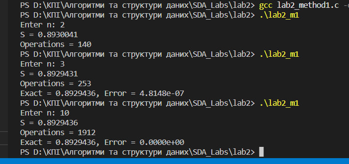
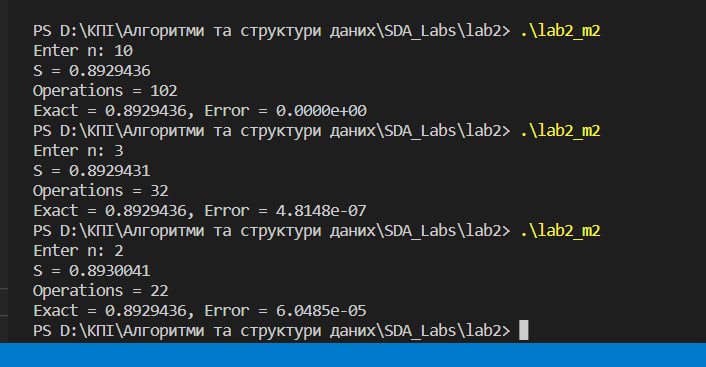
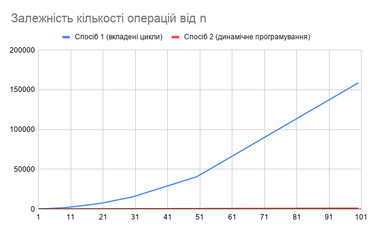
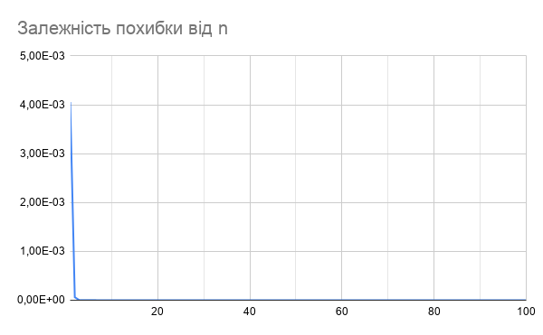

# ЗВІТ з лабораторної роботи № 2
**Тема:** Алгоритми з вкладеними циклами та метод динамічного програмування  
**Дисципліна:** Структури даних та алгоритми  
**Виконав:** студент 1 курсу, групи ІО-61, Скиба Даниїл Васильович  
**Перевірив:** Русінов Володимир Володимирович  
**Варіант:** 21  

---

## 1. Мета роботи
Засвоєння теоретичного матеріалу та набуття практичних навичок використання циклічних конструкцій, вкладених циклів, методу динамічного програмування та підрахунку кількості операцій алгоритмів.

## 2. Постановка задачі (Варіант 21)
Для заданого натурального числа n обчислити значення функції cos²(x) при x = 1/3 за формулою:

S = cos²(x) = 1 - Σ(i=1..n) [ (-1)^(i+1) · 2^(2i-1) · x^(2i) / (2i)! ], де x = 1/3

Завдання:
1. Написати дві програми мовою C (з використанням типу double, вивід із 7 знаками після коми):
   - Спосіб 1: обчислення за допомогою вкладених циклів (без функції pow).
   - Спосіб 2: обчислення одним циклом методом динамічного програмування (накопичення чергового доданка через попередній).
2. Підрахувати кількість операцій для n = 1, 2, 3, 10, 20, 30, 50, 100.
3. Побудувати графіки залежності кількості операцій та похибки від n і перевірити обчислення на калькуляторі.

---

## 3. Програмна реалізація
Файли з вихідним кодом знаходяться в цій же папці:
- [lab2_method1.c](lab2_method1.c) — вкладені цикли.
- [lab2_method2.c](lab2_method2.c) — метод динамічного програмування.

Рекурентна формула переходу до наступного доданка для Способу 2:
a(i) = a(i-1) · (-4 · x²) / ((2i - 1) · 2i)

---

## 4. Результати тестування програм

### Спосіб 1 (вкладені цикли)

### Спосіб 2 (динамічне програмування)

---

## 5. Таблиця кількості операцій та похибки

| n | 1 | 2 | 3 | 10 | 20 | 30 | 50 | 100 |
|---|---|---|---|---|---|---|---|---|
| **Кількість операцій, спосіб 1 (вкладені цикли)** | 58 | 140 | 253 | 1912 | 6917 | 15022 | 40532 | 158557 |
| **Кількість операцій, спосіб 2 (динамічне програмування)** | 12 | 22 | 32 | 102 | 202 | 302 | 502 | 1002 |
| **Абсолютна похибка** | 4.0547e-03 | 6.0485e-05 | 4.8148e-07 | 0 | 0 | 0 | 0 | 0 |

---

## 6. Графіки залежностей

### Залежність кількості операцій від n

### Залежність похибки обчислень від n

---

## 7. Перевірка правильності обчислень на калькуляторі

Точне значення: cos²(1/3) ≈ (0.944956946)² ≈ 0.8929436

**Перевірка для n = 2:**
- i = 1: a1 = ((-1)² · 2¹ · (1/3)²) / 2! = (1 · 2 · 1/9) / 2 = 1/9 ≈ 0.1111111
- i = 2: a2 = ((-1)³ · 2³ · (1/3)⁴) / 4! = (-1 · 8 · 1/81) / 24 = -1/243 ≈ -0.0041152
- S(2) = 1 - (1/9 - 1/243) = 1 - 26/243 = 217/243 ≈ 0.8930041 (збігається з програмою: 0.8930041).

**Перевірка для n = 3:**
- i = 3: a3 = ((-1)⁴ · 2⁵ · (1/3)⁶) / 6! = (1 · 32 · 1/729) / 720 = 2/32805 ≈ 0.0000610
- S(3) = 0.8930041 - 0.0000610 = 0.8929431 (збігається з програмою: 0.8929431).

---

## 8. Висновки
Під час виконання я порівняв два підходи до обчислення суми ряду для cos²(1/3). З таблиці та графіків видно, що у першому способі  кількість операцій зростає квадратично — від 58 при n = 1 до 158 557 при n = 100. У другому способі кількість операцій зростає лінійно — від 12 до 1002, що при n = 100 у 158 разів ефективніше. Похибка швидко зменшується і вже при n = 10 дорівнює нулю в межах точності типу double, а перевірка вручну підтвердила правильність результатів.